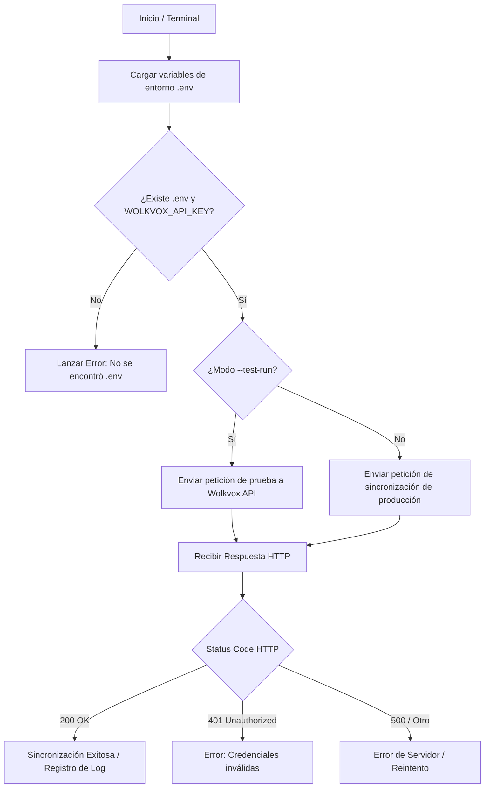

# Documentación Integral del Proyecto Conecta-EduCo (Paso 7)

---

## 1. README.md - Información General y Propósito

### Autores y Coautoría
* **Diego Sánchez:** Arquitectura de software, desarrollo del script de sincronización (`sync_wolkvox.py`) y configuración de entornos.
* **Santiago Santa López:** Control de versiones, gestión de despliegues, documentación y diseño de planes de reversión (*rollback*).

### Propósito del Proyecto
Automatización de reglas de enrutamiento y conectividad segura con la API de Wolkvox mediante un script en Python, cumpliendo con los estándares de calidad ISO/IEC 25010.

---

## 2. CHANGELOG.md - Bitácora de Cambios (Semantic Versioning)

| Versión | Fecha | Autor | Descripción de Cambios |
| :--- | :--- | :--- | :--- |
| `v1.0.0` | 2026-03-30 | Diego Sánchez | Estructura inicial del repositorio y script base de sincronización. |
| `v1.1.0` | 2026-03-31 | Santiago Santa López | Implementación de bitácora de cambios y versionado semántico. |
| `v1.2.0` | 2026-04-01 | Santiago Santa López & Diego Sánchez | Documentación completa de manuales y validación de tablas ISO/IEC 25010. |

---

## 3. Manual de Usuario y Guía de Operación

### Puesta en Marcha (Paso a Paso)
1. **Configuración de Credenciales:** Copiar `.env.example` a `.env` y configurar `WOLKVOX_API_KEY`.
2. **Prueba de Conectividad:** Ejecutar `python sync_wolkvox.py --test-run`.
3. **Ejecución en Producción:** Ejecutar `python sync_wolkvox.py`.

### Resolución de Problemas (Troubleshooting)

| Síntoma o Error | Causa Probable | Solución Recomendada |
| :--- | :--- | :--- |
| `HTTP 401 Unauthorized` | Credenciales incorrectas o caducadas en el archivo `.env`. | Verifique que su `WOLKVOX_API_KEY` esté escrita correctamente y sin espacios adicionales. |
| `No se encontró el archivo .env` | El archivo de configuración de entorno no fue creado o renombrado. | Asegúrese de crear el archivo `.env` en la raíz del proyecto basándose en el ejemplo. |
| `Error: Python no se reconoce...` | Python no está agregado al PATH del sistema operativo. | Reinstale Python seleccionando la opción de añadir al PATH o utilice el comando `py` alternativo. |

---

## 4. Tablero de Seguimiento y Gestión de Proyecto (Kanban)

| ID | Tarea / Historia de Usuario | Estado | Responsable | Evidencia / Resultado |
| :--- | :--- | :--- | :--- | :--- |
| **TS-01** | Configuración inicial del repositorio en GitHub | **Done** | Diego Sánchez | Repositorio activo y estructurado |
| **TS-02** | Desarrollo del script de sincronización (`sync_wolkvox.py`) | **Done** | Diego Sánchez | Conexión exitosa `HTTP 200 OK` |
| **TS-03** | Redacción del archivo `README.md` (Propósito y rollback) | **Done** | Santiago Santa López | Documento publicado en GitHub |
| **TS-04** | Creación de la Bitácora de Cambios (`CHANGELOG.md`) | **Done** | Santiago Santa López | Versionado semántico aplicado |
| **TS-05** | Elaboración del Manual de Usuario y Guía de Troubleshooting | **Done** | Santiago Santa López | Instrucciones operativas listas |
| **TS-06** | Consolidación de artefactos para Google Sites y entrega final | **In Progress** | Diego Sánchez & Santiago Santa López | En proceso de integración web |

---

## 5. Manual Técnico y Arquitectura

### Diagrama de Flujo (Mermaid)

### Gestión de Variables de Entorno (.env)
El sistema utiliza el estándar de segregación de secretos para no exponer credenciales sensibles dentro del control de versiones.

| Variable | Tipo | Descripción | Ejemplo / Valor |
| :--- | :--- | :--- | :--- |
| WOLKVOX_API_KEY | String (Secret) | Clave única de autenticación de la API Wolkvox | wlk_live_987654321xyz |
| WOLKVOX_ENDPOINT | URL | Punto de enlace base para las peticiones REST | https://api.wolkvox.com/v2/ |
| ENVIRONMENT | String | Entorno de ejecución (development / production) | production |

### Manejo de Códigos de Respuesta HTTP
El script procesa de forma explícita los siguientes estados de respuesta devueltos por los servidores de Wolkvox:

| Código HTTP | Significado Técnico | Comportamiento del Software |
| :--- | :--- | :--- |
| 200 OK | Solicitud procesada correctamente. | Muestra confirmación en consola y finaliza la tarea con éxito. |
| 400 Bad Request | Sintaxis o cuerpo de la petición mal formado. | Aborta la solicitud y registra los parámetros enviados en el log. |
| 401 Unauthorized | API Key ausente, errónea o sin permisos. | Cancela la operación e indica al usuario revisar el archivo .env. |
| 404 Not Found | Endpoint o recurso solicitado inexistente. | Notifica que la URL base o la ruta de la API está mal configurada. |
| 500 Internal Server Error | Fallo en los servidores remotos de Wolkvox. | Activa la rutina de excepción y sugiere reintentar en unos minutos. |

### Mantenimiento y Soporte Técnico
Para soporte de nivel 2 o modificaciones en la arquitectura del script, contactar a los líderes de desarrollo:
* **Diego Sánchez:** Arquitectura de integración y consumo de API.
* **Santiago Santa López:** Pruebas de entorno, seguridad y control de despliegue.
